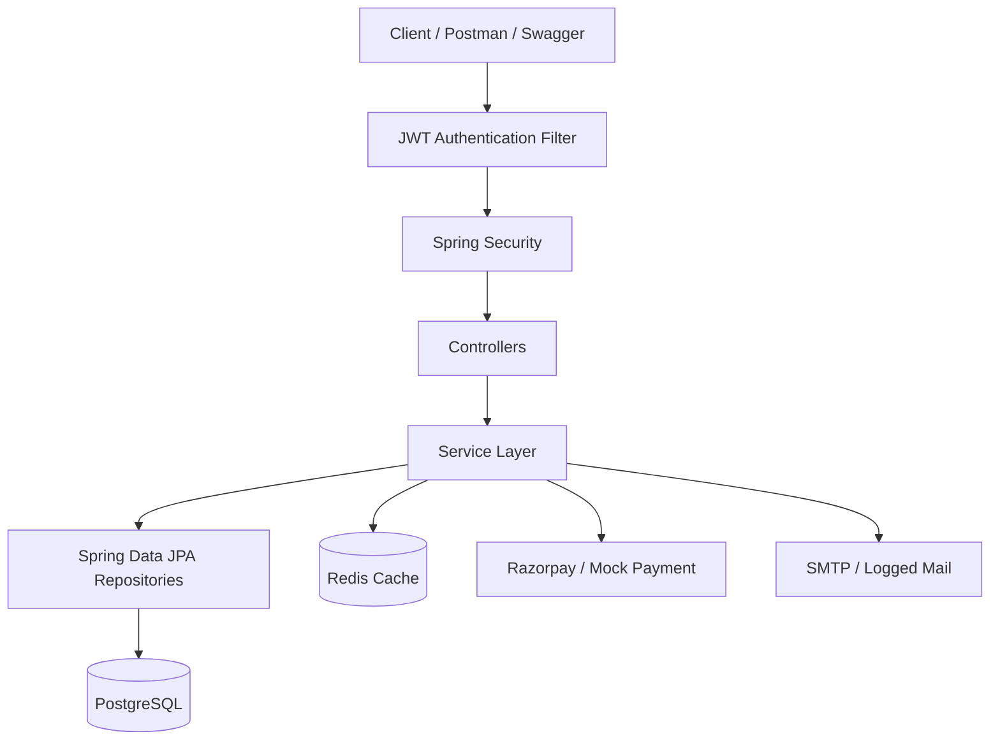

# E-Commerce Backend / Order Management System

A production-style RESTful backend for an e-commerce platform, built with Spring Boot. Supports product catalog browsing, cart management, order checkout with real-time inventory tracking, payment processing, and admin order management.

## Overview

This is the backend engine for an online store — the part that handles accounts, product catalog, cart, checkout, inventory, payments, and order fulfillment. It's designed to be run locally, tested via Swagger/Postman, and deployed via Docker.

**Live demo of the flow:**
1. Register/login → get a JWT
2. Browse/search products (public)
3. Add items to cart → checkout → order created, stock reduced, payment record created
4. Track order status: `PENDING → CONFIRMED → PROCESSING → SHIPPED → DELIVERED` (or `CANCELLED`)
5. Admin manages products and updates order status

## Features

- **Authentication & Authorization** — JWT-based login/register, BCrypt password hashing, role-based access (`CUSTOMER` / `ADMIN`)
- **Product Catalog** — CRUD (admin-only writes), pagination, sorting, category filter, keyword search
- **Cart** — add/update/remove items, stock validation, one cart per user
- **Order Checkout** — atomic transaction: validates cart, re-checks stock, calculates total, creates order + order items, reduces inventory, clears cart, creates payment record, sends confirmation email
- **Order Status State Machine** — enforces valid transitions only (e.g. can't jump `PENDING → DELIVERED`)
- **Inventory Management** — stock reduced on order, restored on cancellation, validated at every write path
- **Payments** — Razorpay integration (test/sandbox mode) with a safe mock fallback when credentials aren't configured, so the project runs fully offline
- **Email Notifications** — order confirmation + status update emails, logged instead of sent when SMTP isn't configured
- **Redis Caching** — product listing/detail/search results cached, evicted on writes
- **Global Exception Handling** — clean, consistent JSON error responses, no leaked stack traces
- **Validation** — Jakarta Bean Validation on all request DTOs
- **API Docs** — Swagger/OpenAPI UI
- **Tests** — unit tests (Mockito) + MockMvc integration tests covering the full checkout flow and negative cases
- **Docker** — one-command startup (app + PostgreSQL + Redis)

## Tech Stack

| Layer | Technology |
|---|---|
| Language | Java 17 |
| Framework | Spring Boot 3.3 |
| Security | Spring Security 6 + JWT (jjwt 0.12) |
| Persistence | Spring Data JPA, PostgreSQL |
| Caching | Redis (Spring Cache abstraction) |
| Payments | Razorpay Java SDK (+ mock fallback) |
| Mail | Spring Mail |
| Docs | springdoc-openapi (Swagger UI) |
| Build | Maven |
| Testing | JUnit 5, Mockito, MockMvc, H2 (test profile) |
| Containerization | Docker, Docker Compose |

## Architecture



Layered structure — controllers never contain business logic; that lives entirely in the service layer:

```
controller/  → REST endpoints, request/response mapping
service/     → business logic (interfaces + impl/)
repository/  → Spring Data JPA repositories
entity/      → JPA entities
dto/         → request/response DTOs (entities are never exposed directly)
mapper/      → entity <-> DTO conversion
security/    → JWT filter, UserDetails, JwtUtil
exception/   → custom exceptions + global handler
config/      → Security, Redis, OpenAPI, dev data seeder
```

## Database Design

| Entity | Key Fields | Relationships |
|---|---|---|
| `User` | name, email, password, role | 1—1 `Cart`, 1—N `Order` |
| `Product` | name, price, stockQuantity, category | referenced by `CartItem`, `OrderItem` |
| `Cart` | user | 1—N `CartItem` |
| `CartItem` | cart, product, quantity, price | N—1 `Cart`, N—1 `Product` |
| `Order` | user, totalAmount, status, paymentStatus, shippingAddress | 1—N `OrderItem`, 1—1 `Payment` |
| `OrderItem` | order, product, quantity, price | N—1 `Order`, N—1 `Product` |
| `Payment` | order, paymentId, amount, status | 1—1 `Order` |

## Authentication

- Register at `POST /api/auth/register` → returns a JWT immediately (auto-login on signup)
- Login at `POST /api/auth/login` → returns a JWT
- Send the token as `Authorization: Bearer <token>` on subsequent requests
- Roles: `CUSTOMER` (default on registration) and `ADMIN` (seeded, see credentials below)

## API Endpoints

### Auth (public)
| Method | Path | Description |
|---|---|---|
| POST | `/api/auth/register` | Register a new customer |
| POST | `/api/auth/login` | Login, get JWT |

### Products
| Method | Path | Auth | Description |
|---|---|---|---|
| GET | `/api/products` | Public | List, paginated, optional `?category=` |
| GET | `/api/products/search?keyword=` | Public | Search by name/description |
| GET | `/api/products/{id}` | Public | Get one product |
| POST | `/api/products` | ADMIN | Create product |
| PUT | `/api/products/{id}` | ADMIN | Update product |
| DELETE | `/api/products/{id}` | ADMIN | Delete product |

### Cart (authenticated)
| Method | Path | Description |
|---|---|---|
| GET | `/api/cart` | Get current user's cart |
| POST | `/api/cart/items` | Add item (increments if present) |
| PUT | `/api/cart/items/{productId}?quantity=` | Set exact quantity |
| DELETE | `/api/cart/items/{productId}` | Remove one item |
| DELETE | `/api/cart` | Clear cart |

### Orders (authenticated)
| Method | Path | Description |
|---|---|---|
| POST | `/api/orders` | Checkout (cart → order) |
| GET | `/api/orders` | List own orders, paginated |
| GET | `/api/orders/{id}` | Get one order (own only) |
| POST | `/api/orders/{id}/cancel` | Cancel (PENDING/CONFIRMED only) |

### Admin
| Method | Path | Description |
|---|---|---|
| GET | `/api/admin/orders` | List all orders |
| PUT | `/api/admin/orders/{id}/status` | Update order status (validated transitions) |

### Users
| Method | Path | Description |
|---|---|---|
| GET | `/api/users/me` | Current user's profile |

Full interactive docs: **`/swagger-ui/index.html`**

## Project Structure

See [Architecture](#architecture) above for the package layout.

## Setup Instructions

### Prerequisites
- Java 17+
- Maven 3.8+
- PostgreSQL 16 (or use Docker Compose)
- Redis 7 (or use Docker Compose)

### Environment Variables

Copy `.env.example` to `.env` and fill in values (or export them directly):

```bash
cp .env.example .env
```

| Variable | Required | Default | Notes |
|---|---|---|---|
| `DB_URL` | Yes | `jdbc:postgresql://localhost:5432/ecommerce` | |
| `DB_USERNAME` | Yes | `postgres` | |
| `DB_PASSWORD` | Yes | `postgres` | |
| `REDIS_HOST` / `REDIS_PORT` | Yes | `localhost` / `6379` | |
| `JWT_SECRET` | Yes | dev placeholder in `application.properties` | **Generate your own**: `openssl rand -base64 32` |
| `JWT_EXPIRATION_MS` | No | `86400000` (24h) | |
| `RAZORPAY_ENABLED` | No | `false` | Set `true` + provide keys for real Razorpay orders |
| `RAZORPAY_KEY_ID` / `RAZORPAY_KEY_SECRET` | No | placeholder | Only used if enabled |
| `MAIL_ENABLED` | No | `false` | Set `true` + provide SMTP creds to actually send mail |
| `MAIL_USERNAME` / `MAIL_PASSWORD` | No | placeholder | Only used if mail enabled |
| `CORS_ALLOWED_ORIGINS` | No | `http://localhost:3000` | Comma-separated |

**Never commit `.env` or real secrets** — `.gitignore` already excludes it.

### Running Locally (without Docker)

1. Start PostgreSQL and Redis locally (or via `docker compose up postgres redis`)
2. Create the database: `createdb ecommerce`
3. Export env vars or rely on `application.properties` defaults for local dev
4. Run:
   ```bash
   mvn clean install
   mvn spring-boot:run
   ```
5. App starts on `http://localhost:8080`. Seed data loads automatically on first run.

### Running with Docker

```bash
docker compose up --build
```

This starts the app, PostgreSQL, and Redis together, with the app waiting on healthy DB/Redis before starting. App is available at `http://localhost:8080`.

To stop: `docker compose down` (add `-v` to also wipe the DB volume).

### Testing

```bash
mvn test
```

Runs the full test suite:
- **Unit tests** (Mockito): `ProductServiceImplTest`, `CartServiceImplTest`, `OrderServiceImplTest` — cover stock validation, invalid order transitions, unauthorized access, empty-cart checkout, inventory restoration on cancel
- **Integration tests** (MockMvc + H2, `test` profile): `AuthControllerIT`, `ProductControllerIT`, `OrderFlowIT` — cover registration/login, RBAC enforcement (403s), full checkout flow end-to-end, admin status transitions

### Sample API Requests

**Register:**
```bash
curl -X POST http://localhost:8080/api/auth/register \
  -H "Content-Type: application/json" \
  -d '{"name":"Jane Doe","email":"jane@example.com","password":"SecurePass1"}'
```

**Login:**
```bash
curl -X POST http://localhost:8080/api/auth/login \
  -H "Content-Type: application/json" \
  -d '{"email":"asha@example.com","password":"Customer@123"}'
```

**Add to cart** (replace `<TOKEN>`):
```bash
curl -X POST http://localhost:8080/api/cart/items \
  -H "Authorization: Bearer <TOKEN>" \
  -H "Content-Type: application/json" \
  -d '{"productId":1,"quantity":2}'
```

**Checkout:**
```bash
curl -X POST http://localhost:8080/api/orders \
  -H "Authorization: Bearer <TOKEN>" \
  -H "Content-Type: application/json" \
  -d '{"shippingAddress":"123 Main St, Bangalore"}'
```

## Default Development Credentials

Seeded automatically on first startup (see `DataSeeder`):

| Role | Email | Password |
|---|---|---|
| Admin | `admin@ecommerce.com` | `Admin@123` |
| Customer | `asha@example.com` | `Customer@123` |
| Customer | `rahul@example.com` | `Customer@123` |

Plus 12 seed products across 5 categories (Electronics, Footwear, Apparel, Home & Kitchen, Books, Bags).

## Future Improvements

- Pessimistic/optimistic DB-level locking on stock decrement for stronger oversell protection under high concurrency (current implementation re-checks stock inside the transaction but doesn't hold a row lock)
- Refresh tokens / token revocation list
- Product image upload (S3 or similar) instead of a plain `imageUrl` string
- Order refunds and partial fulfillment
- Rate limiting on auth endpoints
- CI pipeline (GitHub Actions) running `mvn test` on every push

## Limitations

- **Payments**: Real Razorpay integration is implemented but requires your own API keys (`RAZORPAY_ENABLED=true`); without them, the app uses a deterministic mock payment reference so checkout still works end-to-end.
- **Email**: Same pattern — without SMTP credentials, emails are logged rather than sent (`MAIL_ENABLED=false` by default).
- **Concurrency**: Stock checks happen inside a `@Transactional` method with `READ_COMMITTED` isolation; this significantly reduces but does not fully eliminate oversell risk under very high concurrent load without additional DB-level locking (see Future Improvements).

## Author

Built as a portfolio/resume project demonstrating a complete Spring Boot backend: security, persistence, caching, third-party integration, testing, and containerization.
